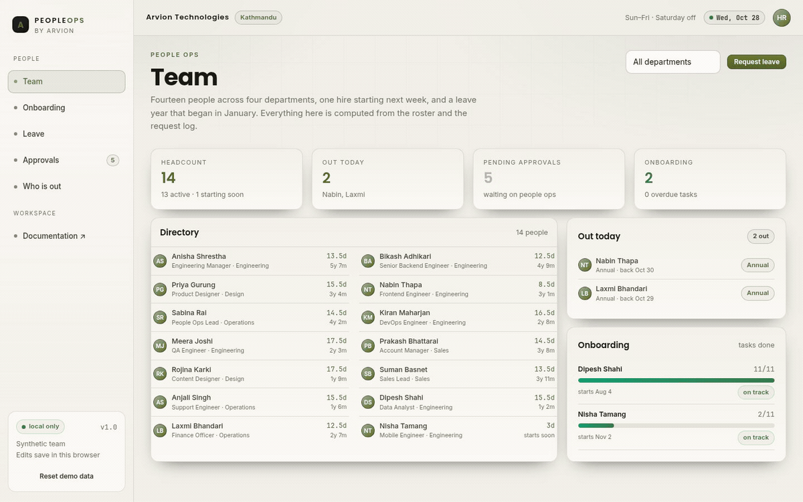
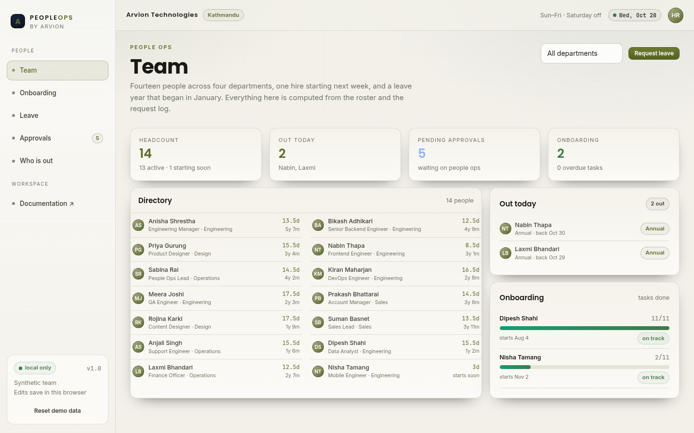
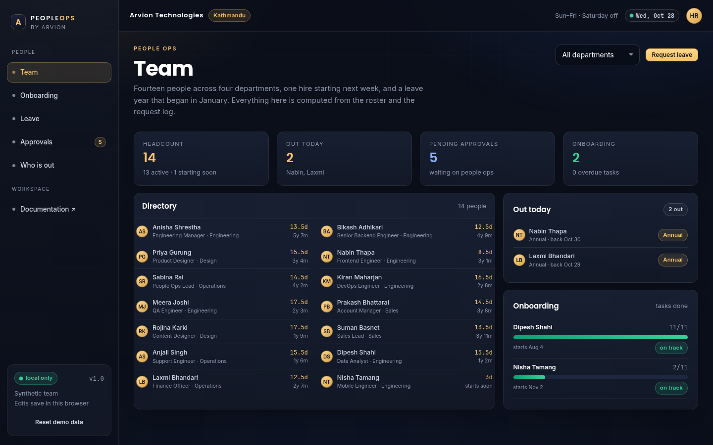

<div align="center">

</div>

<sub>Recorded from the live demo — <a href="docs/demo.mp4">MP4</a> · <a href="docs/screenshot.png">static frame</a></sub>

# PeopleOps

HR operations for a studio of fourteen: a people directory with leave balances,
onboarding checklists with real due dates, a leave request form that checks
itself, an approvals queue and a who-is-out calendar.

[**Open the live demo**](https://arvion-technology.github.io/labs/demos/peopleops/demo/) · [CI](https://github.com/arvion-technology/peopleops/actions/workflows/ci.yml) · [MIT](LICENSE)

---

Most HR tools are bought for the features nobody uses and priced per seat. This
one is the opposite: four screens, one rulebook, no server. The demo team is
fictional — fourteen people, four departments, a handful of leave requests — but
every balance, warning and date on screen is calculated by `src/leave.js` and
`src/onboarding.js`, which the tests import directly.

The two things worth reading are the leave balance calculation and the request
validator. Both are small, both are pure functions, and both encode decisions
that are usually buried in a settings page: how carry-over is capped, whether a
Saturday consumes leave, and what "overlap" means.

## What it does

- **Team** — headcount, who is out today, pending approvals and onboarding
  progress, above a two-column directory with each person's available annual
  leave and tenure.
- **Onboarding** — one board per hire, five phases from pre-start to day 30,
  tasks dated in working days around the start date. Tick a task and it is
  saved; the equipment list shows what has been issued.
- **Leave** — pick a person, a type and two dates. The form reports working days,
  the balance after approval, and every reason a request cannot go through
  (over balance, overlap, past date, empty range). Submit and it enters the
  queue.
- **Approvals** — the queue re-validates each request against the current
  balance before showing it. Approve or reject with a reason; the decision is
  recorded.
- **Who is out** — a month calendar of approved leave with public holidays
  marked, plus a fourteen-day load strip so you can see the week a whole team
  disappears.

Edits are kept in `localStorage`. The reset button rebuilds the seeded team.

## Screenshots

| Team directory | Onboarding board |
| --- | --- |
|  |  |

## Architecture

```
 demo/index.html ──► demo/app.js ──┬──► src/leave.js       accrual, balances, overlap, validation
                                   ├──► src/onboarding.js  working-day dates, phases, progress
                                   └──► src/data.js        roster, policies, templates, holidays

 arvion.css / arvion.js   shell, tables, forms (shared, untouched)
 test/                    27 node:test cases with a frozen clock
```

`demo/app.js` renders and routes. It does not compute a balance by itself: every
number passes through a function in `src/`, and that function has a test. The
only state held outside the seeded data is the request log and which onboarding
tasks are ticked.

A leave request is a plain object:

```js
{
  id: "LR-115",
  personId: "p7",
  type: "annual",              // annual | sick | casual | unpaid
  from: 1793577600000,         // Monday 2 November 2026, UTC midnight
  to: 1793923200000,           // Friday 6 November 2026
  status: "pending",           // pending | approved | rejected
  requestedAt: 1793318400000,
  decidedAt: null,
  decidedBy: null,
  note: "Wedding in Chitwan"
}
```

## How leave is calculated

The leave year starts on 1 January. Each type has a monthly accrual rate, a
yearly entitlement and a carry-over cap:

| Type | Accrual | Entitlement | Carry-over cap |
| --- | --- | --- | --- |
| Annual | 1.5 days / month | 18 | 5 |
| Sick | 1 day / month | 12 | 0 |
| Casual | 0.5 days / month | 6 | 0 |
| Unpaid | — | — | — |

For a person who has been employed since before the leave year, the balance is:

```
accrued  = min(entitlement, completed_months × monthly_rate)
carried  = min(carry_over_cap, last_year_balance)
available = accrued + carried − used − booked
```

`used` counts approved requests that have already started; `booked` counts
approved requests later in the year. Both are measured in working days, so a
request that spans a Saturday costs one day less. On 28 October, nine completed
months of annual leave is `min(18, 9 × 1.5) = 13.5` days — which is why the demo
directory shows balances like 13.5 and 16.5 rather than a flat 18.

Overlap is inclusive at both ends: a request ending on 4 November conflicts with
one starting on 4 November. Only pending and approved requests count — a rejected
request never blocks a new one.

`validateRequest` returns an array of problems rather than the first one, because
the form displays all of them at once. A request can fail for a missing person, a
reversed range, a start in the past, a range with no working days, more than
fifteen consecutive days, insufficient balance, or an overlap. Approval re-runs
the same check and shows the flags again; a manager can still approve over a
warning, which is deliberate — the flag is information, not a hard block.

## How onboarding dates are generated

A template task is stored as an offset in working days, not a date: `contract` is
−5, `laptop` is −1, `first PR` is +2. `addWorkingDays` walks the calendar in the
right direction, skipping Saturdays and public holidays, so a laptop is dated
before day one and a two-week check-in lands fourteen working days later. The
five board columns are derived from the offset: pre-start, day 1, week 1, week 2,
and everything after.

Tasks are considered overdue when their due date is in the past and they are not
ticked. That single rule drives the red edge on the card, the overdue count in
the progress panel and the warning on the team page.

## Quickstart

```bash
git clone https://github.com/arvion-technology/peopleops.git
cd peopleops
npm test          # 27 tests, no dependencies, Node 20+
npm run demo      # http://localhost:4173
```

There is nothing to install. To use the leave maths in your own code:

```js
import { leaveBalance, validateRequest } from "./src/leave.js";

const balance = leaveBalance(person, requests, "annual");
// { accrued: 13.5, carried: 5, used: 5, booked: 5, available: 8.5, ... }

const check = validateRequest(
  { personId: "p1", type: "annual", from, to },
  { person, requests, now: Date.now() },
);
// { ok: boolean, errors: [{ code, message }], workingDays, remaining }
```

## Tests

```bash
npm test
```

27 cases on `node:test`, with `now` fixed to 28 October 2026. The leave suite
covers the Saturday and holiday calendar, monthly accrual and its entitlement
cap, carry-over caps, used-versus-booked balances, inclusive overlap, conflict
filtering, every validation error code, immutable approval decisions, the
who-is-out calendar, holiday handling, availability rates, pending ordering and
the type summary. The onboarding suite covers working-day arithmetic in both
directions, phase mapping, derived due dates, overdue flags, progress and next
task, board grouping, and equipment holdings.

The demo bundle also has a static check for broken asset references and leftover
placeholder text:

```bash
node scripts/serve-check.mjs
```

## Limitations

No server, no authentication and no audit log: two People Ops staff editing in
different browsers would not see each other's changes, because everything lives
in `localStorage`. The office week is fixed to Sunday–Friday with Saturday off;
festival holidays are a static list rather than a maintained calendar. There is
no half-day leave, no hourly leave and no accrual mid-month proration — someone
joining on the 20th accrues from the first of the following month, which is
simpler than what most payroll systems do.

Leave cannot be edited after submission, only approved or rejected. There is no
email, no Slack notification and no export to payroll. Onboarding covers the
first 30 days and equipment issue, not offboarding or asset depreciation.

The people, balances and requests are synthetic.

## Project layout

```text
peopleops/
├── demo/
│   ├── index.html      # team, onboarding, leave, approvals, calendar
│   ├── app.js          # rendering, form validation, board interactions
│   ├── styles.css      # board, calendar, balances, validation states
│   ├── arvion.css      # shared design system (not edited)
│   └── arvion.js       # shared helpers (not edited)
├── src/
│   ├── data.js         # seeded roster, policies, templates, holidays
│   ├── leave.js        # accrual, balances, overlap, validation, decisions
│   └── onboarding.js   # working-day dates, phases, progress
├── test/               # 27 node:test cases
├── scripts/            # static server, screenshots, bundle checks
└── .github/workflows/  # CI: tests on Node 20 and 22
```

## Credits

Built by [Arvion Technologies](https://arviontech.net) in Kathmandu, part of our
open-source [Labs](https://github.com/arvion-technology/labs) series. We build
internal tools for clients; leave policy is a good test of whether a team can
write down a rule precisely enough for a program to follow it.

MIT licensed.
